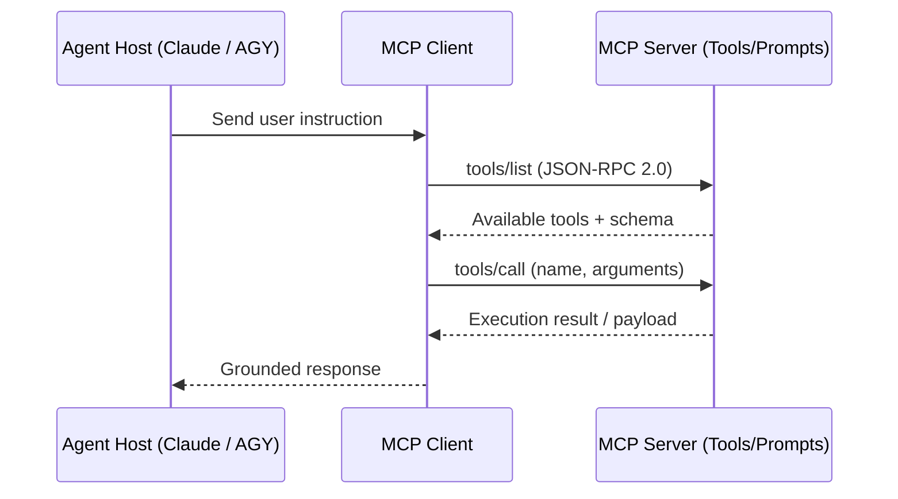

# 🌐 Curated Awesome MCP Registry

> Comprehensive curated registry and architecture guide for Model Context Protocol (MCP) servers, clients, toolkits, and agentic integrations.

---

## 📑 Registry Directory

### 🚀 Developer Tools & Terminals
- **Docker MCP**: Inspect, manage, and execute containerized workflows.
- **PostgreSQL / MySQL MCP**: Read schemas, execute sanitized queries, and analyze explain plans.
- **Git & GitHub MCP**: Autonomous repository inspections, PR reviews, and issue triage.

### 🌐 Web & Browser Automation
- **SpectraBrowser MCP**: Stealth Chromium CDP automation with autonomous DOM navigation.
- **InfinityScrape MCP**: High-throughput distributed web intelligence scraper.

### 🧠 Corporate OSINT & Intelligence
- **AI Researcher MCP**: Deep company dossier compilation and executive leadership research.

### 💼 Jobs & Hiring Data
- **[JobsPipe MCP](https://github.com/jobspipe/mcp)**: Search live job postings from 30+ ATS feeds and job boards ([docs](https://docs.jobspipe.dev/ai-agents/mcp), endpoint `https://mcp.jobspipe.dev/mcp`).

### 🛡️ Systems & Security
- **Phantom Fortress MCP**: Kernel-level cyber telemetry inspection and threat analysis.

---

## 🛠️ Model Context Protocol Specification

---

## 🤝 Contributing

1. Fork this repository.
2. Add your MCP server entry following the schema format.
3. Submit a Pull Request!

---
*Curated by [Fearlessversee](https://github.com/Fearlessversee)*
